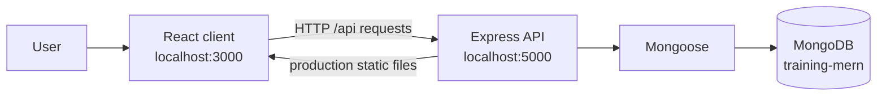

# Daymark Tasks | Project Guide

## 1. Project Summary

Daymark Tasks is a lightweight, single-user task planner. It lets a user capture tasks, mark them complete, remove them, and see a simple summary of progress. The browser client is a React application; an Express API validates requests and stores task documents in MongoDB through Mongoose.

The project is suitable as a learning or capstone prototype. It does not currently include accounts, team workspaces, task sharing, due dates, or priority levels.

## 2. Capabilities

- Create a task with a title of up to 160 characters.
- List tasks, newest first.
- Mark a task complete or reopen it.
- Delete a task.
- Filter the list to all, to-do, or completed tasks.
- View counts and a completion percentage.
- Receive loading, empty, retry, and API error feedback in the client.
- Check the API and MongoDB connection through a health endpoint.
- Use the responsive React development server or serve the production build through Express.

## 3. Technology

| Area                   | Technology                                   |
| ---------------------- | -------------------------------------------- |
| Browser client         | React 16, Create React App (`react-scripts`) |
| API server             | Node.js, Express 4                           |
| Data access            | Mongoose 5                                   |
| Database               | MongoDB                                      |
| Presentation generator | PptxGenJS                                    |

The client uses a development proxy to forward `/api` requests to `http://localhost:5000`. In production, Express serves the compiled client from `client/build`.

## 4. Architecture



### Request lifecycle

1. The React app fetches the task list when the page loads.
2. The client sends create, update, and delete requests to the Express API.
3. The task router checks database availability and validates user-provided values and MongoDB IDs.
4. Mongoose reads or mutates task documents in MongoDB.
5. The API returns JSON; the client updates its state or displays a useful error.

## 5. Data Model

Tasks are stored in the `tasks` collection in the `training-mern` database. Mongoose manages the MongoDB `_id` and the schema timestamps.

| Field       | Type     | Behavior                                  |
| ----------- | -------- | ----------------------------------------- |
| `_id`       | ObjectId | MongoDB document identifier               |
| `title`     | String   | Required, trimmed, maximum 160 characters |
| `done`      | Boolean  | Defaults to `false`                       |
| `createdAt` | Date     | Added by Mongoose timestamps              |
| `updatedAt` | Date     | Added by Mongoose timestamps              |

## 6. API Reference

Base URL during development: `http://localhost:5000`.

| Method   | Path                    | Purpose                         | Successful response                      |
| -------- | ----------------------- | ------------------------------- | ---------------------------------------- |
| `GET`    | `/api/health`           | Report MongoDB connection state | `200` with `{ "database": "connected" }` |
| `GET`    | `/api/tasks`            | List tasks, newest first        | `200` with a task array                  |
| `POST`   | `/api/tasks/add`        | Create a task                   | `201` with the created task              |
| `POST`   | `/api/tasks/update/:id` | Set a task's completion state   | `200` with the updated task              |
| `DELETE` | `/api/tasks/delete/:id` | Delete a task                   | `200` with the deleted task              |

### Request examples

Create a task:

```json
{
  "title": "Prepare project presentation"
}
```

Update completion state:

```json
{
  "done": true
}
```

### Error responses

- `400 Bad Request`: empty or overlong title, invalid task ID, invalid completion value, or malformed JSON.
- `404 Not Found`: a syntactically valid task ID that does not match a document.
- `503 Service Unavailable`: MongoDB is not connected.
- `500 Internal Server Error`: unexpected server-side failure.

Error responses use a JSON object with an `error` field. The UI displays the returned message and offers a retry action when the initial task load fails.

## 7. Local Setup

### Requirements

- Node.js and npm.
- MongoDB running locally, or a reachable MongoDB connection string.

### Install dependencies

From the repository root:

```powershell
npm install
Push-Location client
npm install
Pop-Location
```

### Configure MongoDB

By default, the server connects to:

```text
mongodb://127.0.0.1:27017/training-mern
```

To use a different local or hosted database, set `MONGODB_URI` before starting the API. Start MongoDB before the backend; the backend waits for a successful database connection and exits with an error if it cannot connect.

### Run the development app

Use separate terminals from the repository root.

Terminal 1, API:

```powershell
npm start
```

Terminal 2, React client:

```powershell
Push-Location client
npm start
```

Open `http://localhost:3000`. The client proxy sends API calls to port `5000`.

### Build and serve production files

```powershell
npm run build
npm run start:prod
```

The production server serves the client and API from `http://localhost:5000`. MongoDB must remain available.

## 8. Presentation

The editable slide deck is `docs/Daymark-Capstone-Overview.pptx`. Its source is `scripts/generate-presentation.js`. With root dependencies installed, regenerate the deck using:

```powershell
npm run presentation
```

The presentation covers the problem, user workflow, interface, architecture, data model, API, reliability, local setup, and future roadmap. Product capabilities are separated from proposed future work.

## 9. Verification Checklist

### Build and health

- Run `npm run build` and confirm the React production build succeeds.
- Run `npm start` with MongoDB available.
- Request `GET /api/health`; expect `200` and `database: connected`.

### Task workflow

- Create a task with a normal title.
- Confirm it appears in the list and the counts update.
- Mark it complete; confirm the completed filter contains it.
- Reopen it and delete it.
- Submit an empty title; expect a visible validation error.
- Stop MongoDB and confirm the API reports database unavailability instead of leaving a request hanging.
- Check the layout at desktop and mobile widths.

## 10. Known Limitations and Next Steps

- No authentication or user-scoped data; do not expose this prototype publicly as a private task service.
- No due dates, priorities, task editing, reordering, or collaboration.
- Automated test coverage is not configured at the repository root; the current root `test` script is a placeholder.
- The frontend and Mongoose dependency versions are legacy. Review `npm audit` output and plan a tested dependency upgrade before public deployment.
- For a production deployment, add authentication and authorization, validate configuration at startup, use HTTPS, add structured logging and monitoring, and establish automated API and browser tests.
